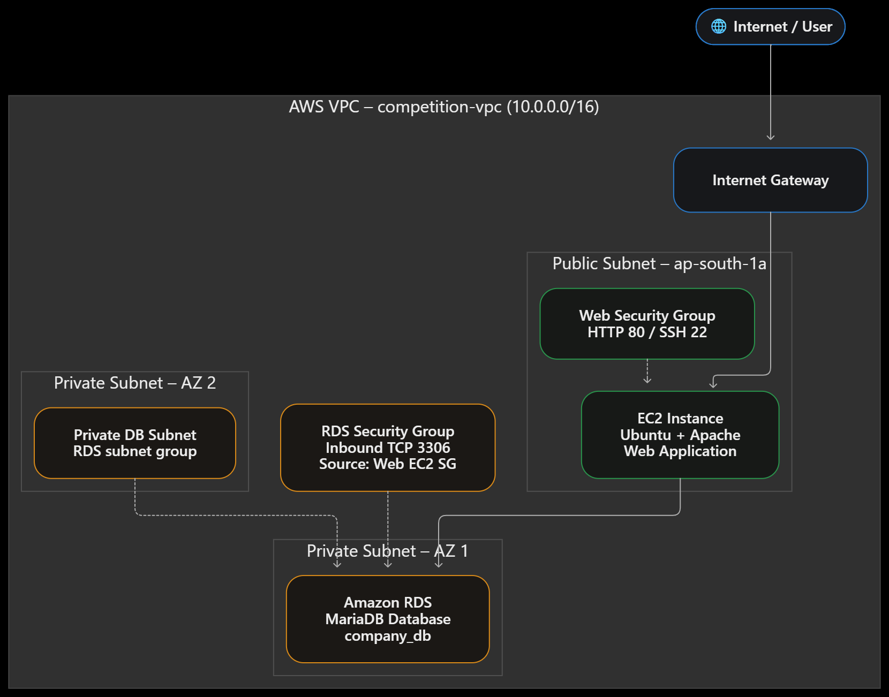
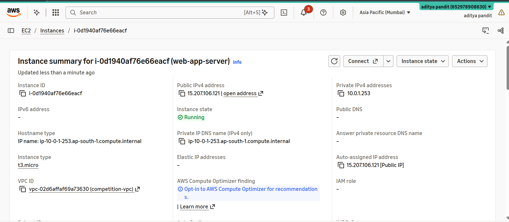
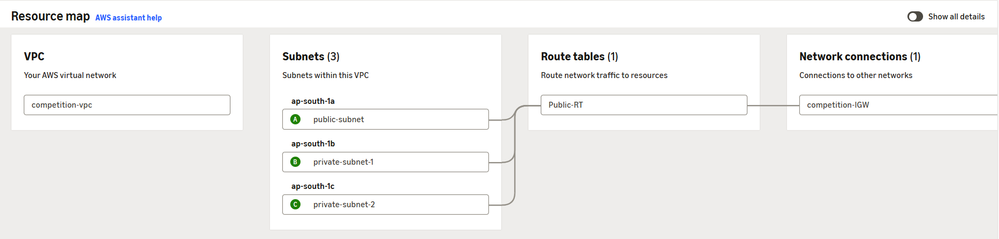
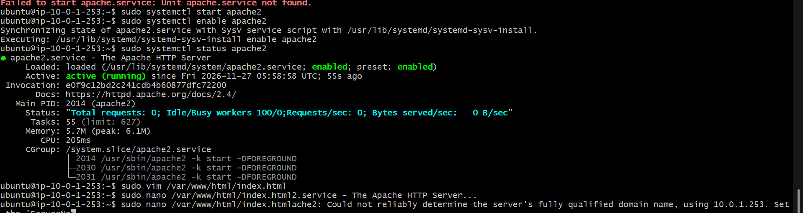
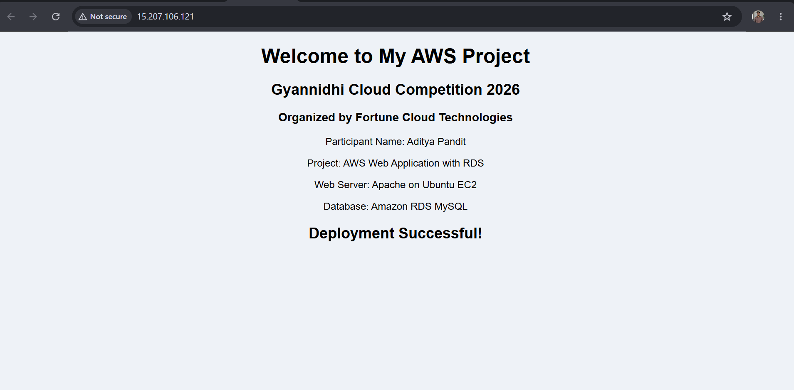
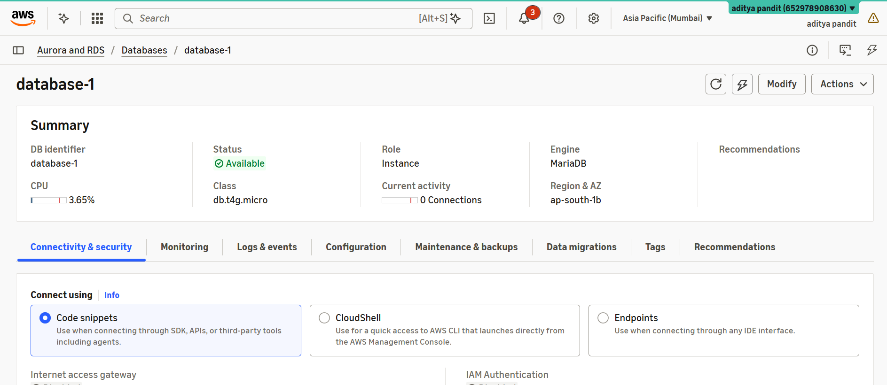
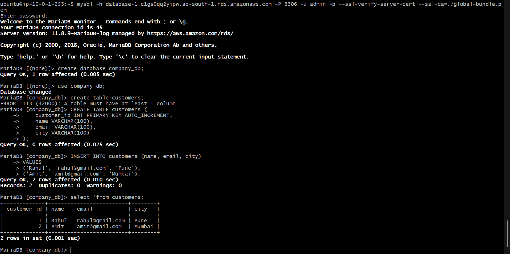

# # Gyannidhi -- Cloud Competition 2026

## AWS Practical Infrastructure Challenge

**Organized by:** Fortune Cloud Technologies\
**Date:** 27 November 2026\
**Cloud platform:** Amazon Web Services (AWS)

------------------------------------------------------------------------

## Project Overview

This repository documents the implementation of three AWS practical

## AWS Services and Technologies

-   Amazon VPC, EC2 and RDS
-   MariaDB / SQL
-   Application Load Balancer (ALB)
-   Security Groups, Route Tables and Internet Gateway
-   IAM and Amazon CloudWatch
-   Ubuntu Linux and Apache
-   Git and GitHub

------------------------------------------------------------------------

# Task 1 -- Web Application Deployment with Amazon RDS

## Objective

Host a publicly accessible web application on an EC2 instance and store
customer information in a private Amazon RDS database.

## Network Configuration

  Resource                Configuration
  ----------------------- ---------------
  VPC                     `10.0.0.0/16`
  Public subnet           `10.0.1.0/24`
  Private subnet 1        `10.0.2.0/24`
  Private subnet 2        `10.0.3.0/24`
  EC2 operating system    Ubuntu
  Web server              Apache
  RDS engine configured   MariaDB
  HTTP                    TCP `80`
  SSH                     TCP `22`
  Database                TCP `3306`

## Architecture Diagarm



## Implementation

1.  Created a custom VPC with CIDR `10.0.0.0/16`.
2.  Created one public subnet (`10.0.1.0/24`).
3.  Created two private subnets (`10.0.2.0/24` and `10.0.3.0/24`) in
    different Availability Zones.
4.  Created and attached an Internet Gateway.
5.  Configured the public route table with `0.0.0.0/0` routed to the
    Internet Gateway.
6.  Launched an Ubuntu EC2 instance in the public subnet.
7.  Installed and configured Apache.
8.  Published a customized HTML competition webpage.
9.  Created an RDS MariaDB database using the private DB subnet group.
10. Disabled public accessibility for the database.
11. Configured the RDS security group to allow TCP `3306` only from the
    EC2 security group.
12. Connected to RDS from the EC2 instance.
13. Created the `company_db` database and `customers` table.
14. Inserted customer records and retrieved them using SQL.

## Security Group Rules

  Security group   Protocol / type     Port Source
  ---------------- ----------------- ------ ---------------------------
  EC2-SG           SSH                   22 Approved administrator IP
  EC2-SG           HTTP                  80 `0.0.0.0/0`
  RDS-SG           MariaDB/MySQL       3306 EC2-SG

## SQL Validation

``` sql
CREATE DATABASE company_db;
USE company_db;

CREATE TABLE customers (
    customer_id INT PRIMARY KEY AUTO_INCREMENT,
    name VARCHAR(100),
    email VARCHAR(100),
    city VARCHAR(100)
);

INSERT INTO customers (name, email, city)
VALUES
('Rahul', 'rahul@example.com', 'Pune'),
('Amit', 'amit@example.com', 'Mumbai');

SELECT * FROM customers;

## website URL : http://15.207.106.121/
```
## Screenshots
## Instance Running


## VPC  


## Apache Running


## Website LIVE


## RDS


## Database



------------------------------------------------------------------------


## Author

**Name:** Aditya Pandit\
**GitHub:** https://github.com/adityapandit5552/

------------------------------------------------------------------------